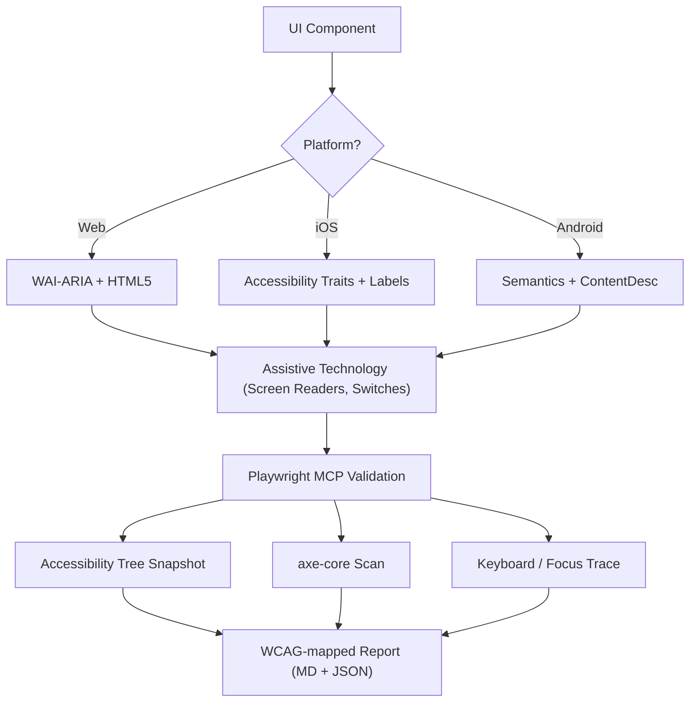
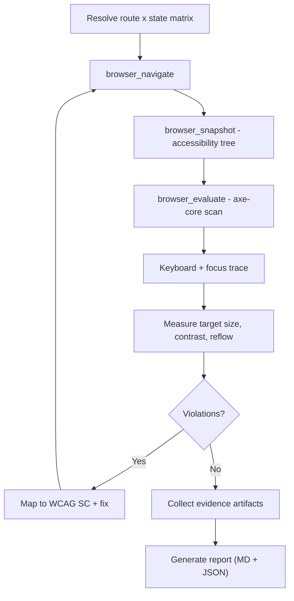

---
name: accessibility
description: Design, implement, and audit accessible UI to WCAG 2.2 Level AA across Web, iOS, and Android — semantic ARIA roles and labels, accessibility traits and hints, focus management, contrast, target size, and screen-reader support. Includes automated validation with Playwright MCP (accessibility tree + axe-core) and a WCAG-mapped audit report. Use when building or auditing UI for accessibility compliance, keyboard navigation, or screen-reader support.
metadata:
  origin: ECC
---

# Accessibility (WCAG 2.2)

This skill ensures that digital interfaces are Perceivable, Operable, Understandable, and Robust (POUR) for all users, including those using screen readers, switch controls, or keyboard navigation. It focuses on the technical implementation of WCAG 2.2 success criteria, and pairs every criterion with an executable check driven by **Playwright MCP** so that compliance is proven, not assumed.

## When to Use

- Defining UI component specifications for Web, iOS, or Android.
- Auditing existing code for accessibility barriers or compliance gaps.
- Implementing new WCAG 2.2 standards like Target Size (Minimum) and Focus Appearance.
- Mapping high-level design requirements to technical attributes (ARIA roles, traits, hints).
- Running an automated accessibility pass in CI and producing a WCAG-mapped report.

## Core Concepts

- **POUR Principles**: The foundation of WCAG (Perceivable, Operable, Understandable, Robust).
- **Semantic Mapping**: Using native elements over generic containers to provide built-in accessibility.
- **Accessibility Tree**: The representation of the UI that assistive technologies actually "read."
- **Focus Management**: Controlling the order and visibility of the keyboard/screen reader cursor.
- **Labeling & Hints**: Providing context through `aria-label`, `accessibilityLabel`, and `contentDescription`.
- **Executable Evidence**: Every checklist item maps to a Playwright MCP step and a stored artifact.

## How It Works

### Step 1: Identify the Component Role

Determine the functional purpose (e.g., Is this a button, a link, or a tab?). Use the most semantic native element available before resorting to custom roles.

### Step 2: Define Perceivable Attributes

- Ensure text contrast meets **4.5:1** (normal) or **3:1** (large/UI).
- Add text alternatives for non-text content (images, icons).
- Implement responsive reflow (up to 400% zoom without loss of function).

### Step 3: Implement Operable Controls

- Ensure a minimum **24x24 CSS pixel** target size (WCAG 2.2 SC 2.5.8).
- Verify all interactive elements are reachable via keyboard and have a visible focus indicator (SC 2.4.11).
- Provide single-pointer alternatives for dragging movements.

### Step 4: Ensure Understandable Logic

- Use consistent navigation patterns.
- Provide descriptive error messages and suggestions for correction (SC 3.3.3).
- Implement "Redundant Entry" (SC 3.3.7) to prevent asking for the same data twice.

### Step 5: Verify Robust Compatibility

- Use correct `Name, Role, Value` patterns.
- Implement `aria-live` or live regions for dynamic status updates.

### Step 6: Validate with Playwright MCP

Turn the checklist into executable evidence. Playwright MCP drives a real browser and exposes the **accessibility tree** as first-class output, so validation is tree-first, not screenshot-first.

| MCP Tool | Accessibility Use |
| :--- | :--- |
| `browser_navigate` | Load the route/state under test |
| `browser_snapshot` | Read the **accessibility tree** (role, name, state) — primary evidence |
| `browser_evaluate` | Inject `axe-core`; measure target size, contrast, focus indicators, DOM order |
| `browser_press_key` | Keyboard-only pass (`Tab`, `Shift+Tab`, `Enter`, `Space`, `Escape`, arrows) |
| `browser_resize` | Reflow / 400% zoom and small-viewport target size |
| `browser_console_messages` | Catch ARIA/DOM warnings that silently break the tree |
| `browser_take_screenshot` | Supporting artifact only — focus rings, reflow breakpoints |

### Step 7: Generate the Audit Report

Emit Markdown for humans + JSON for CI. Every finding carries WCAG SC, severity, selector, evidence source (axe rule id / tree node / measurement), and a fix. Regression-gate the pipeline on new or unresolved critical findings.

## Accessibility Architecture Diagram



## Cross-Platform Mapping

| Feature            | Web (HTML/ARIA)          | iOS (SwiftUI)                        | Android (Compose)                                           |
| :----------------- | :----------------------- | :----------------------------------- | :---------------------------------------------------------- |
| **Primary Label**  | `aria-label` / `<label>` | `.accessibilityLabel()`              | `contentDescription`                                        |
| **Secondary Hint** | `aria-describedby`       | `.accessibilityHint()`               | `Modifier.semantics { stateDescription = ... }`             |
| **Action Role**    | `role="button"`          | `.accessibilityAddTraits(.isButton)` | `Modifier.semantics { role = Role.Button }`                 |
| **Live Updates**   | `aria-live="polite"`     | `.accessibilityLiveRegion(.polite)`  | `Modifier.semantics { liveRegion = LiveRegionMode.Polite }` |

## Examples

### Web: Accessible Search

```html
<form role="search">
  <label for="search-input" class="sr-only">Search products</label>
  <input type="search" id="search-input" placeholder="Search..." />
  <button type="submit" aria-label="Submit Search">
    <svg aria-hidden="true">...</svg>
  </button>
</form>
```

### iOS: Accessible Action Button

```swift
Button(action: deleteItem) {
    Image(systemName: "trash")
}
.accessibilityLabel("Delete item")
.accessibilityHint("Permanently removes this item from your list")
.accessibilityAddTraits(.isButton)
```

### Android: Accessible Toggle

```kotlin
Switch(
    checked = isEnabled,
    onCheckedChange = { onToggle() },
    modifier = Modifier.semantics {
        contentDescription = "Enable notifications"
    }
)
```

## Anti-Patterns to Avoid

- **Div-Buttons**: Using a `<div>` or `<span>` for a click event without adding a role and keyboard support.
- **Color-Only Meaning**: Indicating an error or status _only_ with a color change (e.g., turning a border red).
- **Uncontained Modal Focus**: Modals that don't trap focus, allowing keyboard users to navigate background content while the modal is open. Focus must be contained _and_ escapable via the `Escape` key or an explicit close button (WCAG SC 2.1.2).
- **Redundant Alt Text**: Using "Image of..." or "Picture of..." in alt text (screen readers already announce the role "Image").
- **Screenshot-Only Auditing**: Treating a visual pass as accessibility evidence — the accessibility tree is the source of truth.
- **Default-State-Only Testing**: Auditing the happy path and ignoring error, loading, empty, and expanded states, where most violations hide.

## Automated Validation with Playwright MCP

### Validation Loop



Audit **every state**, not just default: error, loading, empty, expanded, disabled.

### A. Snapshot first, never the screenshot

`browser_snapshot` returns the accessibility tree. If a control is missing,
unnamed, or has the wrong role there, no visual pass saves it. The snapshot is
ground truth for Name, Role, Value (SC 4.1.2).

### B. axe-core via `browser_evaluate`

MCP ships no axe tool — inject it:

```js
// browser_evaluate
async () => {
  if (!window.axe) {
    await new Promise((res, rej) => {
      const s = document.createElement('script');
      s.src = 'https://cdn.jsdelivr.net/npm/axe-core@4/axe.min.js';
      s.onload = res; s.onerror = rej;
      document.head.appendChild(s);
    });
  }
  const r = await window.axe.run(document, {
    runOnly: { type: 'tag', values: ['wcag2a', 'wcag2aa', 'wcag21aa', 'wcag22aa'] }
  });
  return r.violations.map(v => ({
    id: v.id, impact: v.impact, wcag: v.tags.filter(t => t.startsWith('wcag')),
    help: v.help,
    nodes: v.nodes.map(n => ({ target: n.target, summary: n.failureSummary }))
  }));
}
```

axe-core covers only ~30–40% of WCAG issues. Keyboard, focus visibility, focus
order, and meaningful alt text remain manual — mark them `manual` in the report.

### C. Keyboard & focus trace

Drive `browser_press_key Tab` in a loop, re-snapshotting each step. Assert every
interactive element appears in the tree, focus never falls to `<body>`, and the
focused element shows a visible indicator (SC 2.4.7 / 2.4.11).

```js
// browser_evaluate — focusable inventory + indicator visibility
() => [...document.querySelectorAll('a[href],button,input,select,textarea,[tabindex]:not([tabindex="-1"])')]
  .filter(el => el.offsetParent !== null)
  .map(el => {
    const s = getComputedStyle(el), r = el.getBoundingClientRect();
    return {
      name: (el.getAttribute('aria-label') || el.textContent || '').trim().slice(0, 60),
      role: el.getAttribute('role') || el.tagName.toLowerCase(),
      visibleIndicator: (s.outlineStyle !== 'none' && s.outlineWidth !== '0px') || s.boxShadow !== 'none',
      w: +r.width.toFixed(1), h: +r.height.toFixed(1)
    };
  });
```

### D. Target size (SC 2.5.8, WCAG 2.2)

Flag rendered boxes under 24×24 CSS px without the spacing exception:

```js
() => [...document.querySelectorAll('a,button,[role="button"],input[type="checkbox"],input[type="radio"]')]
  .map(el => { const r = el.getBoundingClientRect();
    return { sel: el.className || el.tagName, w: +r.width.toFixed(1), h: +r.height.toFixed(1) }; })
  .filter(x => x.w > 0 && (x.w < 24 || x.h < 24));
```

### E. Reflow / zoom (SC 1.4.10)

`browser_resize` to 320 CSS px wide (≈ 400% zoom at 1280 px), re-snapshot, and
assert no horizontal scroll and no clipped content.

### F. Modal focus containment (SC 2.1.2)

Open the modal, `Tab` through the full cycle — focus must never reach background
content — then press `Escape` and confirm focus returns to the trigger.

### G. Live regions (SC 4.1.3)

Trigger async updates and confirm `aria-live` announcements. Use
`browser_console_messages` to surface ARIA/DOM warnings that break the tree.

### Playwright MCP anti-patterns

- **Screenshot-only auditing** — the accessibility tree is the evidence.
- **Trusting axe alone** — it cannot judge focus order, focus visibility, or
  whether alt text is *meaningful*.
- **Default state only** — error, loading, empty, and expanded states hide most
  real violations.
- **Mouse-only paths** — `browser_click` passes never expose keyboard traps.

## Report Generation

Emit two artifacts per run: Markdown for reviewers, JSON for CI diffing.

### Markdown template

```markdown
# Accessibility Audit — <route> — <date>
Standard: WCAG 2.2 Level AA
Method: axe-core 4.x + Playwright MCP accessibility tree + manual keyboard pass

## Summary
| Severity | Count |
| :--- | :--- |
| Critical | 2 |
| Serious  | 5 |
| Moderate | 3 |
| Minor    | 1 |

Automated coverage note: axe-core detects ~30–40% of WCAG issues. Items marked
`manual` were verified via accessibility tree + keyboard trace.

## Findings

### A11Y-001 — Icon-only button has no accessible name
- **WCAG:** 4.1.2 Name, Role, Value (Level A)
- **Severity:** Critical
- **Selector:** `form[role="search"] > button[type="submit"]`
- **Evidence:** `browser_snapshot` → `button` node with empty name; axe rule `button-name`
- **Impact:** Screen reader announces "button" with no purpose.
- **Fix:** add `aria-label="Submit Search"` (SVG already `aria-hidden="true"`).
- **Verify:** re-run snapshot + axe; node name must equal "Submit Search".

### A11Y-002 — Target size below minimum
- **WCAG:** 2.5.8 Target Size (Minimum) (Level AA, 2.2)
- **Severity:** Serious
- **Selector:** `.pagination__dot`
- **Evidence:** measured 16×16 CSS px via `browser_evaluate`
- **Fix:** pad to ≥24×24 or widen spacing to satisfy the exception.

## Manual Verification Log
| Check | Method | Result |
| :--- | :--- | :--- |
| Focus order | 42 × `browser_press_key Tab` | Pass |
| Focus visible | computed outline/box-shadow per element | 3 fails |
| Modal trap | Tab cycle + `Escape` | Pass |
| Reflow @320px | `browser_resize` | Fail — horizontal scroll |

## Artifacts
- `a11y-report.json` — raw axe output + measurements
- `focus-trace.json`
- `screenshots/` — focus indicators, reflow breakpoints

## Fix Priority
1. Critical / serious automated violations
2. Keyboard reachability + focus visibility
3. Target size / reflow
4. Manual backlog (color-only meaning, error suggestion text)
```

### JSON artifact (for CI)

```json
{
  "meta": { "route": "/search", "standard": "WCAG22-AA", "tool": "playwright-mcp+axe-core" },
  "summary": { "critical": 2, "serious": 5, "moderate": 3, "minor": 1 },
  "findings": [
    { "id": "A11Y-001", "wcag": ["4.1.2"], "level": "A", "impact": "critical",
      "selector": "button[type=submit]", "source": "axe:button-name", "status": "open" }
  ],
  "manual": [
    { "check": "focus-order", "result": "pass" },
    { "check": "reflow-320", "result": "fail" }
  ]
}
```

### Regression gating

- Fail the run when `summary.critical > 0` or when a finding id/selector pair is
  new versus the stored baseline.
- Persist `a11y-report.json` as a CI artifact and diff between runs.
- Re-verify each fixed finding with a targeted `browser_snapshot` before closing it.

### Severity mapping

| Impact | WCAG Level | CI Behavior |
| :--- | :--- | :--- |
| Critical | A / AA | Block merge |
| Serious  | AA | Block merge |
| Moderate | AA / AAA | Warn |
| Minor    | Best practice | Report only |

## Best Practices Checklist

- [ ] Interactive elements meet the **24x24px** (Web) or **44x44pt** (Native) target size.
- [ ] Focus indicators are clearly visible and high-contrast.
- [ ] Modals **contain focus** while open, and release it cleanly on close (`Escape` key or close button).
- [ ] Dropdowns and menus restore focus to the trigger element on close.
- [ ] Forms provide text-based error suggestions.
- [ ] All icon-only buttons have a descriptive text label.
- [ ] Content reflows properly when text is scaled.
- [ ] Every audited state validated via `browser_snapshot` (accessibility tree).
- [ ] axe-core scan executed; violations mapped to a WCAG success criterion.
- [ ] Report emitted as Markdown + JSON with evidence and fix priority.

## References

- [WCAG 2.2 Guidelines](https://www.w3.org/TR/WCAG22/)
- [WAI-ARIA Authoring Practices](https://www.w3.org/TR/wai-aria-practices/)
- [iOS Accessibility Programming Guide](https://developer.apple.com/documentation/accessibility)
- [iOS Human Interface Guidelines - Accessibility](https://developer.apple.com/design/human-interface-guidelines/accessibility)
- [Android Accessibility Developer Guide](https://developer.android.com/guide/topics/ui/accessibility)
- [Playwright MCP](https://github.com/microsoft/playwright-mcp)
- [axe-core rules](https://github.com/dequelabs/axe-core/blob/develop/doc/rule-descriptions.md)
- [Deque — axe coverage limitations](https://www.deque.com/axe/core-documentation/)

## Related Skills

- `frontend-patterns`
- `design-system`
- `liquid-glass-design`
- `swiftui-patterns`
- `playwright-patterns`
- `e2e-testing`
